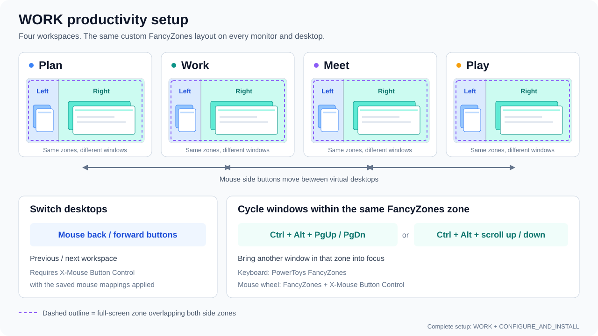

# Windows Install Scripts

Opinionated, interactive provisioning for personal and work Windows 11 computers.

Windows 11 Enterprise is the primary target; see [edition and management requirements](docs/configuration.md#edition-and-management-requirements).

## Quick start

Run in Windows PowerShell 5.1 with WinGet available. Choose the mode and profile interactively; the installer requests administrator access.

```powershell
irm https://raw.githubusercontent.com/erikwihlborg76/windows-install-scripts/main/00-install.ps1 | iex
```

## Choose a setup mode

| Mode | Configure Windows and remove apps | Install applications | Use sync-backed files |
| --- | --- | --- | --- |
| `CONFIGURE_ONLY` | ✅ | ❌ | ❌ |
| `CONFIGURE_AND_INSTALL` | ✅ | ✅ | ❌ |
| `FULL` — author's personal setup | ✅ | ✅ | ✅ |

`FULL` requires the author's [private sync folder](docs/personal-setup.md).

### Choose a HOME or WORK profile (independently of the setup mode)

| Profile behavior | `HOME` | `WORK` |
| --- | --- | --- |
| Prompt to rename the computer | ✅ | ❌ |
| Configure Plan, Work, Meet, and Play virtual desktops | ❌ | ✅ |

## Productivity setup

Choose **WORK** + **CONFIGURE_AND_INSTALL** to set up **Plan**, **Work**, **Meet**, and **Play**, and apply the custom FancyZones layout to all monitors and virtual desktops.



| Action | Control | Requires |
| --- | --- | --- |
| Previous/next desktop | Mouse back/forward | X-Mouse Button Control |
| Previous/next window in a zone | `Ctrl + Alt + PgUp/PgDn` | FancyZones |
| Cycle windows in a zone using the mouse | `Ctrl + Alt + scroll up/down` | Both |

## Details

- [Applications](docs/applications.md): included apps and preferences.
- [Configuration](docs/configuration.md): reduce Windows and Edge distractions, policy limits, and desktop behavior.
- [Running and validation](docs/running-and-validating.md): logs, exit codes, and development checks.
